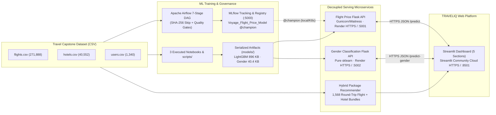
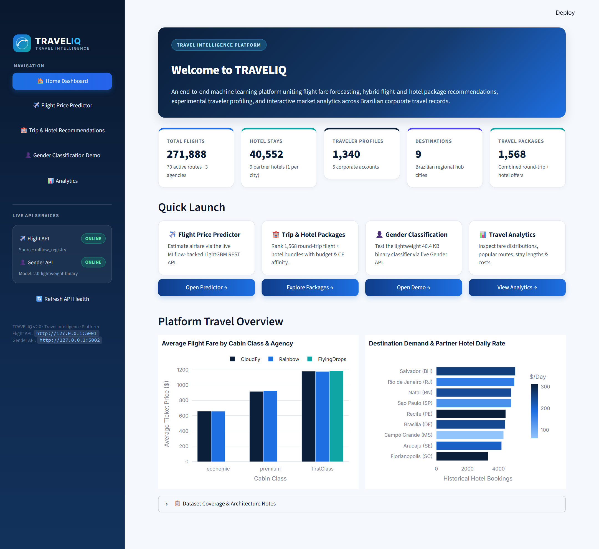
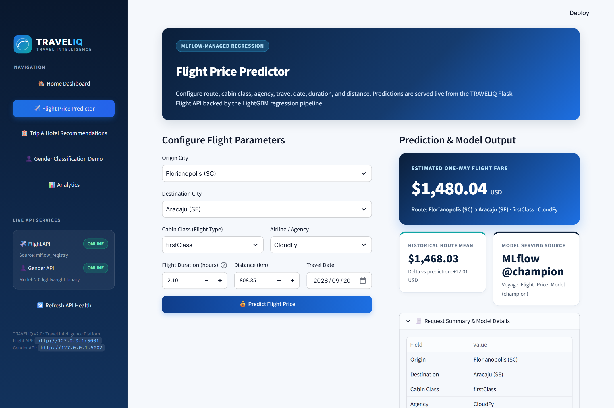
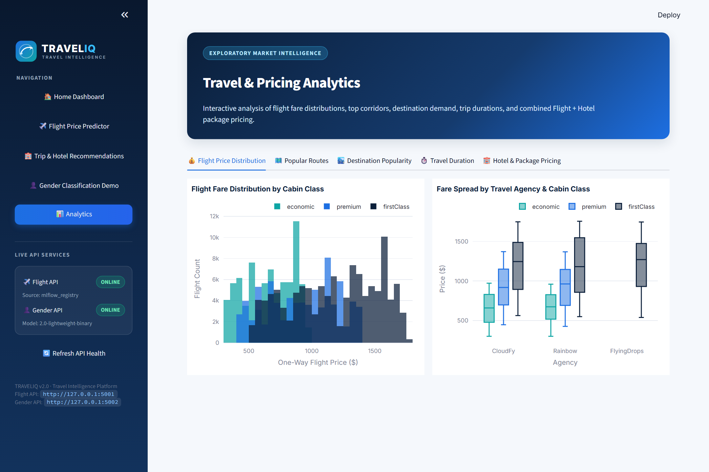
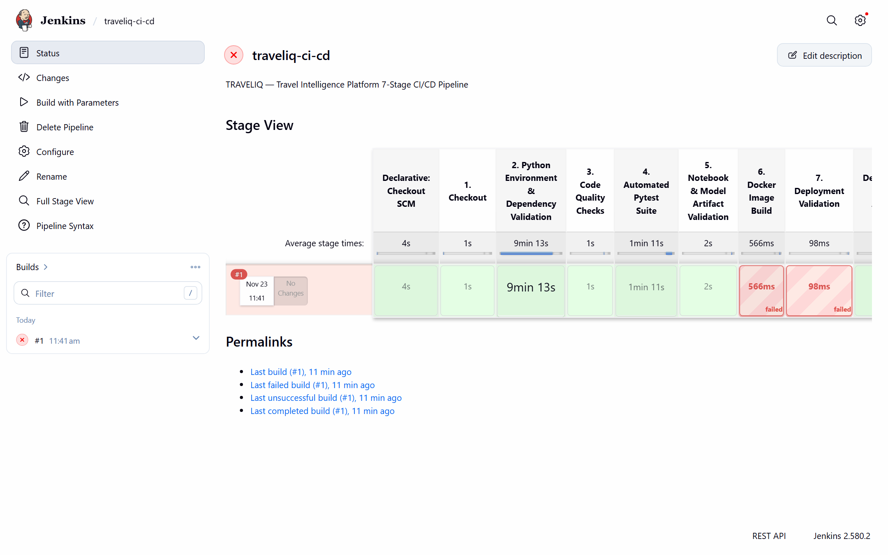

# TRAVELIQ — Travel Intelligence Platform

<p align="left">
  
</p>


**TRAVELIQ** is an end-to-end Travel & Tourism Machine Learning and MLOps platform uniting leakage-free airfare forecasting, hybrid round-trip flight-and-hotel package recommendations, an experimental lightweight binary gender classification microservice, and interactive travel market analytics.

> **Live Deployment (HTTPS):**
> - **Web Application (Streamlit Community Cloud):** https://traveliq-platform-kl4na9wdjyyhudb54njfmt.streamlit.app
> - **Flight Price REST API (Render Free):** https://traveliq-flight-api.onrender.com/health
> - **Gender Classification REST API (Render Free):** https://traveliq-gender-api.onrender.com/health
>
> *Note: Both backend Flask microservices run on Render's Free Tier and sleep after 15 minutes of inactivity. The first request after idle may take 30–50 seconds to wake the containers; TRAVELIQ handles delayed responses gracefully with cloud-aware timeouts.*

---

## 1. Problem Statement

Corporate travel platforms process hundreds of thousands of flight legs and hotel stays across regional hubs, airlines, cabin classes, and agencies, yet machine learning prototypes frequently fail in production due to three structural problems:

1. **Airfare Forecasting Leakage:** Repeated fixed route/airline/cabin schedules cause standard random train/test splits to memorize fare tables rather than generalize to unseen pricing configurations.
2. **Sparse Hotel Inventories:** In this corporate travel dataset, each of the 9 Brazilian cities contains **exactly one partner hotel** with a fixed nightly rate—making hotel-only comparison misleading unless round-trip airfare, stay duration, budget ceilings, and user booking history are modeled jointly.
3. **Production MLOps Fragility:** Deploying raw notebooks without schema alignment, artifact size optimization, automated quality gates, container isolation, or end-to-end tests causes oversized multi-gigabyte containers, runtime schema mismatches, and silent model regressions.

---

## 2. Project Objectives

- **Leakage-Free Flight Fare Regression:** Evaluate five regression models using `GroupShuffleSplit` and `GroupKFold` over unique flight configurations (`MAE`, `MSE`, `RMSE`, `R²`) and serve the LightGBM champion via MLflow `@champion` (with automatic local `.joblib` fallback for cloud & offline resilience).
- **Responsible Lightweight Gender Classification:** Statistically audit `"none"` gender entries, treat undisclosed records as unlabeled (MCAR), replace a 91.9 MB PyTorch/`SentenceTransformer` pickle with a **40.4 KB** pure `scikit-learn` pipeline, transparently report both stratified and unseen-first-name generalization, and enforce prominent Responsible AI disclaimers.
- **Explainable Hybrid Travel Packages:** Join `flights.csv`, `hotels.csv`, and `users.csv` into **1,568 real round-trip Flight + Hotel packages**, evaluate User-Based Collaborative Filtering against a Popularity baseline, and display clear `"Why recommended"` rationale alongside upfront dataset-limitation transparency.
- **Production-Grade Full-Stack & MLOps Architecture:** Deliver decoupled Flask REST microservices, a cohesive 5-page TRAVELIQ Streamlit UI, MLflow tracking & model registry, Docker/Compose definitions, Kubernetes + `autoscaling/v2` HPAs, a 7-stage quality-gated Apache Airflow pipeline, a 7-stage Jenkins `Jenkinsfile`, and a comprehensive 58-test automated `pytest` suite.

---

## 3. Core Features

| TRAVELIQ Module | Capability | Backend / Engine |
|---|---|---|
| **1. Home Dashboard** | Executive KPI strip (`271,888` flights, `40,552` hotel stays, `1,340` profiles, `9` hubs, `1,568` packages), Plotly overview charts, Quick Launch cards, and live sidebar API health pills | Streamlit (`streamlit_app.py`) + parallel `/health` checks |
| **2. Flight Price Predictor** | Forecasts one-way airfare from route, cabin class, agency, duration (hours), distance (km), and travel date with Historical Route Mean delta and provenance badge | Flight REST API (`app/app.py`, Render HTTPS / `:5001`) |
| **3. Trip & Hotel Recommendations** | Filters and ranks 1,568 round-trip Flight + Hotel packages by budget, stay length, cabin, diversity, and optional traveler history with stacked cost breakdown and rationale | Shared Hybrid Engine (`app/recommender.py`) |
| **4. Gender Classification Demo** | Experimental statistical demonstration returning calibrated binary probabilities (`female`/`male`) with an explicit amber Responsible AI notice | Gender REST API (`app/gender_api.py`, Render HTTPS / `:5002`) |
| **5. Travel & Pricing Analytics** | Five interactive Plotly market tabs: Flight Price Distribution, Popular Routes, Destination Popularity, Travel Duration, and Hotel & Package Pricing | Streamlit + Plotly |

---

## 4. System Architecture



> **Cloud Security Posture:** In public cloud deployment (Render Free + Streamlit Community Cloud), **only** the Streamlit UI and stateless inference endpoints (`/health`, `/predict`, `/predict-gender`) are exposed over HTTPS. The MLflow administration interface is **intentionally excluded** from public exposure (`MLFLOW_TRACKING_URI=disabled`), and API URLs/timeouts are injected via Streamlit Secrets rather than hardcoded credentials.

---

## 5. Technology Stack

| Layer | Technologies |
|---|---|
| **Machine Learning** | Python 3.13, `scikit-learn 1.9.1`, `LightGBM 4.7.0`, `XGBoost 3.4.1`, `pandas 3.1.1`, `numpy 2.5.5`, `scipy 1.18.1`, `joblib 1.6.0` |
| **APIs & Serving** | `Flask 3.1.3`, `Gunicorn 23.0.0` (Linux/Render/Docker), `Waitress 3.0.2` (Windows local), `requests 2.34.2` |
| **Frontend & Visualization** | `Streamlit 1.67.0`, `Plotly 7.1.0`, `Matplotlib 3.11.2`, `Seaborn 0.13.2` |
| **Experiment Tracking & MLOps** | `MLflow 3.18.0`, Docker & Docker Compose, Kubernetes + `autoscaling/v2` HPA, Apache Airflow 2.10.5, Jenkins LTS 2.580.2 |
| **Cloud Hosting ($0 Free Tier)** | Render Free Web Services (Docker Flask APIs) + Streamlit Community Cloud (2.7 GB RAM UI) |
| **Quality Assurance** | `pytest 9.2.0` (`58` automated tests across 6 modules), JUnit XML CI archiving |

---

## 6. Dataset Description & Transparency Findings

All source tables live untouched in `travel_capstone_dataset/`:

| Dataset | Dimensions | Nulls / Exact Dupes | Key Exploratory Findings |
|---|---:|---:|---|
| `flights.csv` | `271,888 × 10` | `0` / `0` | 9 Brazilian regional hub cities, 70 directional routes, 3 cabin classes (`economic`, `premium`, `firstClass`), 3 agencies (`CloudFy`, `Rainbow`, `FlyingDrops`), duration in **hours** (`0.44–2.44 h`), `2019–2023`. Contains **490 unique fixed-price flight configurations**, making group-aware splitting mandatory. |
| `hotels.csv` | `40,552 × 8` | `0` / `0` | **Strict 1-to-1 mapping (`9 cities ↔ 9 partner hotels`)** with constant nightly rates and `1–4` stay days. Joins with round-trip `flights.csv` via `travelCode` with **100.0% destination city match** to build **1,568 Flight + Hotel packages**. |
| `users.csv` | `1,340 × 5` | `0` nulls (`440` literal `"none"`) | 5 synthetic corporate accounts, ages `21–65`. Contains `452` `male`, `448` `female`, and `440` (`32.84%`) literal `"none"` entries statistically proven Missing Completely At Random (company $\chi^2\ p = 0.3750$, age ANOVA $p = 0.6185$, `66.8%` first-name overlap with labeled users). Excluded from supervised training as undisclosed labels. |

---

## 7. Machine Learning Methodology & Verified Results

### 7.1 Flight Price Regression (`notebooks/01_flight_price_prediction.ipynb`)
- **Validation:** `GroupShuffleSplit` (80/20 over 490 unique configurations -> **98 completely unseen test configurations**, `50,614` holdout rows) + 3-fold `GroupKFold` cross-validation. Calendar features (`year`, `month`, `day`, `day_of_week`) are explicitly aligned to `int32` for MLflow signature parity.

| Model (50,614 Unseen-Config Test Rows) | MAE (\$) | MSE | RMSE (\$) | R² | Status |
|---|---:|---:|---:|---:|---|
| **LightGBM (Default)** | **41.73** | **2,754.14** | **52.48** | **0.9765** | **Production Champion (`896.3 KB`, `@champion` v2)** |
| XGBoost | 43.09 | 2,966.09 | 54.46 | 0.9746 | Benchmark |
| LightGBM (`GroupKFold` Tuned) | 45.28 | 2,944.11 | 54.26 | 0.9748 | Benchmark |
| Random Forest | 54.63 | 4,976.75 | 70.55 | 0.9575 | Benchmark |
| Linear Regression | 82.13 | 10,001.39 | 100.01 | 0.9145 | Baseline |

### 7.2 Binary Gender Classification & Limitations (`notebooks/02_gender_classification.ipynb`)
- **Refactoring:** Excluded the 440 MCAR `"none"` records (`900` binary labeled records: `720` train / `180` stratified test, zero overlapping user codes or full names). Replaced the starter 91.9 MB `SentenceTransformer`/PyTorch artifact with a **40.4 KB** pure `scikit-learn` pipeline (`app/gender_features.py`: first-name char `2–5` TF-IDF, word TF-IDF, morphological cues, company, age) — a **2,275× size reduction**.

| Classifier (5-Fold Stratified CV + 180 Holdout) | 5-Fold CV F1 | Test Acc | Precision | Recall | Weighted F1 | ROC-AUC |
|---|---:|---:|---:|---:|---:|---:|
| **Tuned Logistic Regression (`C=8.0`, Saved)** | **0.9083** | **0.8833** | **0.8872** | **0.8833** | **0.8830** | **0.9533** |
| Random Forest | 0.8989 | 0.8889 | 0.8920 | 0.8889 | 0.8887 | 0.9666 |
| Calibrated LinearSVC | 0.9040 | 0.8833 | 0.8872 | 0.8833 | 0.8830 | 0.9552 |
| XGBoost | 0.8636 | 0.8722 | 0.8745 | 0.8722 | 0.8720 | 0.9232 |
| LightGBM | 0.8672 | 0.8611 | 0.8648 | 0.8611 | 0.8608 | 0.9426 |

- **Confusion Matrix (`n=180`):** `female`: `75 TP / 15 FN`; `male`: `84 TP / 6 FN`.
- **Transparent Seen vs. Unseen Generalization Audit:**
  - *Seen common first names in test (`110/180`)*: Accuracy `0.9727`, Weighted F1 `0.9726`.
  - *Brand-new first names in test (`70/180`)*: Accuracy `0.7429`, Weighted F1 `0.7454`.
  - *Strict `GroupShuffleSplit` holding out entire first-name groups (`n=168`, `0%` overlap)*: Accuracy `0.6369`, Weighted F1 `0.6366`.
- **Responsible AI Limitation:** Outputs are statistical approximations from historical first-name patterns—**not** verified personal identity—and must never be used for consequential, automated, or policy-sensitive decisions.

### 7.3 Hybrid Travel & Hotel Package Recommender (`notebooks/03_travel_recommendation.ipynb` & `app/recommender.py`)
- Combines **User-Based Collaborative Filtering** (cosine similarity on historical user-destination matrices) with a transparent `0–100` multi-factor package score (Budget Fit, Duration Alignment, Personal/CF Affinity, and Historical Popularity) across **1,568 round-trip Flight + Hotel packages**.
- **Offline CF Benchmark (`1,228` users, time-ordered 80/20 split, `K=3`):** User-Based CF achieves **`HitRate@3 = 0.8974`**, **`Precision@3 = 0.5532`**, **`NDCG@3 = 0.5680`**, and **`100.0%` catalog coverage (`9/9` cities)**—tripling the Popularity baseline's `33.3%` coverage (`3/9` cities).
- **200-Query Stress Test:** `100.0%` budget compliance, `89.7%` exact duration match, `4.78 / 5.00` avg unique destinations per Top-5 explorer query, `95.5%` personalization differentiation, `6/6` edge cases passed, and exact hundredth score parity (`71.28`, `76.99`, `54.91`) between Notebook 03 and `app/recommender.py`.

---

## 8. REST API Documentation (Live on Render Free HTTPS)

### Flight Price API (`app/app.py` · `https://traveliq-flight-api.onrender.com`)
- `GET /health` → Returns `200 OK` with `service`, `status`, `model`, `alias`, and `model_source`.
- `POST /predict` → Validates all fields (rejecting invalid dates, non-positive duration/distance, or identical origin/destination with HTTP `400`).
```json
// Example Request
{
  "from": "Florianopolis (SC)", "to": "Aracaju (SE)",
  "flightType": "firstClass", "agency": "CloudFy",
  "date": "2026-09-20", "time": 2.10, "distance": 808.85
}
// Live Verified Render Response (200 OK)
{
  "currency": "USD",
  "model": "Voyage_Flight_Price_Model",
  "model_alias": "champion",
  "model_source": "local_joblib_fallback",
  "predicted_price": 1480.04
}
```

### Gender Classification API (`app/gender_api.py` · `https://traveliq-gender-api.onrender.com`)
- `GET /health` → Returns `200 OK` with `artifact_size_kb: 40.4`, `artifact_version: "2.0-lightweight-binary"`, and `classes: ["female", "male"]`.
- `POST /predict-gender` → Validates `name`, `company`, and `age` (`1–120` in API; `18–100` in corporate UI) and returns calibrated probabilities + `experimental_notice`.
```json
// Example Request
{"name": "Wilma Mcinnis", "company": "4You", "age": 38}
// Live Verified Render Response (200 OK)
{
  "artifact_version": "2.0-lightweight-binary",
  "confidence": 0.9835,
  "experimental": true,
  "predicted_gender": "female",
  "probabilities": {"female": 0.9835, "male": 0.0165}
}
```

---

## 9. Application, MLflow & CI/CD Screenshots

### Home Dashboard & Flight Price Predictor



### Trip & Hotel Recommendations, Gender Demo & Analytics




### Live MLflow 3.18 Tracking & Model Registry (`@champion` v2)


### Live Jenkins LTS v2.580.2 Pipeline Execution (Stages 1–5 & JUnit `57/57` Verified; Stage 6–7 Pending Local Docker)


---

## 10. MLOps Infrastructure & Honest Verification Matrix

Full architectural deep dive: **[docs/MLOPS_ARCHITECTURE.md](docs/MLOPS_ARCHITECTURE.md)** and **[docs/TRAVELIQ_Technical_Workflow_Documentation.md](docs/TRAVELIQ_Technical_Workflow_Documentation.md)**.

| Component | Key Artifacts | Verification Status | Honest Details |
|---|---|---|---|
| **Render Cloud Docker APIs** | `render.yaml`, `deploy/cloud/Dockerfile.{flight,gender}` | **PASS (Live HTTPS)** | Both Docker containers built & deployed live on Render Free HTTPS; `/health`, `/predict`, and `/predict-gender` verified `200 OK`. |
| **Streamlit Community Cloud UI** | `streamlit_app.py`, `packages.txt`, `.streamlit/config.toml` | **PASS (Live HTTPS)** | Deployed live and communicating with both Render HTTPS APIs via Streamlit Secrets. |
| **MLflow Tracking & Registry** | `scripts/train_flight_model.py`, `app/app.py` | **PASS (Live Local)** | Verified live on `:5000`; `Voyage_Flight_Price_Model@champion` v2 loaded over HTTP with `$0.0000` parity vs. `.joblib`. |
| **Apache Airflow Retraining** | `scripts/mlops_pipeline.py`, `airflow/dags/traveliq_ml_pipeline.py` | **PARTIAL** | All 7 stages, SHA-256 skip-retrain gate, dual F1 quality gates (`>=0.85` stratified & `>=0.58` unseen-name), and MLflow promotion/blocking executed live in sandbox (**PASS**); Dockerized Airflow UI (`:8080`) **NOT TESTED** locally (awaits Docker Desktop). |
| **Jenkins CI/CD** | `Jenkinsfile` | **PARTIAL** | Executed live on Jenkins LTS v2.580.2: Stages 1–5 & JUnit archiving (**57 passed, 0 failed**) **PASS**; Stage 6–7 halted as designed because local Docker Desktop is not yet installed. |
| **Local Docker Compose** | `docker-compose.yml`, `docker/Dockerfile*`, `gender/Dockerfile` | **PARTIAL** | Configs, `libgomp1`, non-root users, health checks, and zero-PyTorch gender hygiene verified by pytest (**PASS**); local `docker compose up` **NOT TESTED** (awaits WSL2 + Docker Desktop). |
| **Kubernetes & HPA** | `kubernetes/*.yaml` (`configmap`, `mlflow`, `deployment`, `service`, `gender-classifier`, `streamlit`, `hpa`) | **PARTIAL** | Manifests, probes, limits, PVC, and `autoscaling/v2` HPAs (Flight `2–5`, Gender `1–4`) verified by pytest (**PASS**); live cluster rollout & HPA load test **NOT TESTED** (awaits local K8s cluster). |

---

## 11. Local Installation & Execution

### Native Python Run (Windows / macOS / Linux)
```powershell
python -m venv .venv
.\.venv\Scripts\Activate.ps1        # Linux/macOS: source .venv/bin/activate
pip install -r requirements.txt

# Terminal 1 — Optional Local MLflow UI & Model Registry (:5000)
mlflow server --backend-store-uri sqlite:///mlflow.db --host 127.0.0.1 --port 5000 --allowed-hosts "localhost:*,127.0.0.1:*,host.docker.internal:5000"

# Terminal 2 — Flight Price API (:5001)
$env:MLFLOW_TRACKING_URI = "http://127.0.0.1:5000"
python -m app.app

# Terminal 3 — Gender Classification API (:5002)
python -m app.gender_api

# Terminal 4 — TRAVELIQ Streamlit Frontend (:8501)
streamlit run streamlit_app.py
```

### Local Container & Cluster Commands (Requires Docker Desktop + Kubernetes)
```bash
# Full 4-service Docker Compose stack
docker compose up --build -d

# Kubernetes + autoscaling/v2 HPAs
kubectl apply -f kubernetes/configmap.yaml -f kubernetes/mlflow.yaml -f kubernetes/deployment.yaml -f kubernetes/service.yaml -f kubernetes/gender-classifier.yaml -f kubernetes/streamlit.yaml -f kubernetes/hpa.yaml

# Apache Airflow retraining stack
docker compose -f airflow/docker-compose.yml up --build -d
```

---

## 12. Automated Testing Results (`58 / 58 PASS`)

```bash
pip install -r requirements-dev.txt
pytest -v
```

| Test Module | Tests | Coverage Scope | Result |
|---|---:|---|---|
| `tests/test_flight_api.py` | `12` | `/health`, valid fare prediction, HTTP `400` validation, `int32` schema alignment, MLflow -> local fallback, caching | **12 PASS** |
| `tests/test_gender_api.py` | `12` | `/health`, calibrated probability sum, Responsible AI notice, `<500 KB` lightweight check, input validation | **12 PASS** |
| `tests/test_recommender.py` | `13` | 1,568 package catalog, 1-hotel-per-city disclosure, Notebook 03 exact score parity, budget & edge cases | **13 PASS** |
| `tests/test_api_client.py` | `8` | HTTP client response parsing, connection failures, timeouts, HTTP `400`/`500` error extraction | **8 PASS** |
| `tests/test_mlops_infrastructure.py` | `8` | Local Dockerfiles, Compose, K8s/HPA, Airflow DAG & gates, `Jenkinsfile`, Render/Streamlit cloud bundle security | **8 PASS** |
| `tests/test_integration.py` | `5` | Live Waitress HTTP roundtrips, MLflow vs. joblib zero-diff parity, end-to-end sandboxed Airflow/MLflow promotion | **5 PASS** |
| **Total** | **`58`** | **Full Application, ML Parity, Cloud Security & MLOps Suite** | **`58 / 58 PASS`** |

---

## 13. Known Limitations & Future Improvements

### Known Limitations
- **Single Partner Hotel per City:** `hotels.csv` maps 9 cities to 9 fixed-rate hotels; multi-hotel comparison within one city requires richer property inventory data.
- **Fixed Historical Fare Table:** `flights.csv` has 490 repeating configurations rather than live dynamic airline yield curves.
- **Gender Generalization & Ethics:** Unseen first-name group F1 (`0.6366`) highlights statistical limitations; the microservice remains strictly experimental and non-consequential.
- **Free-Tier Cold Starts & Pending Local Containers:** Render Free APIs sleep after 15 minutes of inactivity (~30–50s wake-up). Live local Docker Compose, Kubernetes HPA load scaling, Dockerized Airflow UI, and Jenkins Stage 6–7 await Docker Desktop + WSL2 on a container-enabled host.

### Future Improvements
- Execute live local Docker Compose, Kubernetes HPA load benchmarks (`metrics-server`), and Dockerized Airflow UI once Docker Desktop is enabled.
- Add statistical data-drift detection (e.g., Population Stability Index / Evidently) ahead of Airflow Stage 2.
- Integrate multi-property hotel inventory, user ratings, and live airline fare feeds.
- Add API rate limiting, Prometheus/Grafana latency dashboards, and optional bearer authentication for production deployments.

---

## 14. Repository Structure

```text
.
├── .streamlit/config.toml                      # TRAVELIQ Navy/White/Blue theme
├── airflow/                                    # Pinned Airflow 2.10.5 Dockerfile, Compose & 7-stage DAG
├── app/                                        # Decoupled Flight API, Gender API, Recommender, Client & Config
├── assets/traveliq_logo.svg                    # TRAVELIQ vector brand mark
├── deploy/cloud/                               # Lean Render Free Dockerfiles (Flight & Gender APIs)
├── docker/                                     # Local Flight, Streamlit & MLflow Dockerfiles
├── docs/                                       # Technical Workflow (DOCX/MD), MLOps Guide, PPTX, Script, Checklist
├── gender/                                     # Local lightweight Gender API Dockerfile & pinned deps
├── kubernetes/                                 # ConfigMap, MLflow PVC, Deployments, Services, HPAs, Secret template
├── models/                                     # Production LightGBM (896.3 KB) & Gender (40.4 KB) pipelines
├── notebooks/                                  # 3 executed, Colab-compatible capstone notebooks
├── screenshots/                                # Genuine captured UI, MLflow, and Jenkins screenshots
├── scripts/                                    # Flight trainer, 7-stage Airflow pipeline & Windows admin helper
├── tests/                                      # 58 automated unit, infrastructure & integration tests
├── travel_capstone_dataset/                    # Untouched flights.csv, hotels.csv, users.csv
├── ATTRIBUTION.md                              # Starter-project credit & OSS library licenses
├── CONTRIBUTING.md                             # Engineering, testing & Responsible AI contribution guide
├── Jenkinsfile                                 # 7-stage cross-platform CI/CD pipeline
├── docker-compose.yml                          # Local 4-service TRAVELIQ Docker Compose stack
├── packages.txt                                # System package (`libgomp1`) for Streamlit Community Cloud
├── render.yaml                                 # Render Free Blueprint (2 decoupled Flask microservices)
├── requirements.txt                            # Pinned production dependencies
├── requirements-dev.txt                        # Development, notebook & pytest dependencies
└── streamlit_app.py                            # TRAVELIQ 5-page Streamlit web application
```

---

## 15. Acknowledgements, Attribution & Licensing

TRAVELIQ was independently engineered and redesigned from the open-source starter repository structure `voyage-analytics-mlops`. Because the starter codebase did not include an upstream `LICENSE` file, this repository intentionally omits a unilateral root `LICENSE` file and instead provides transparent provenance, starter-codebase credit, and third-party open-source dependency license attributions in **[ATTRIBUTION.md](ATTRIBUTION.md)**.
