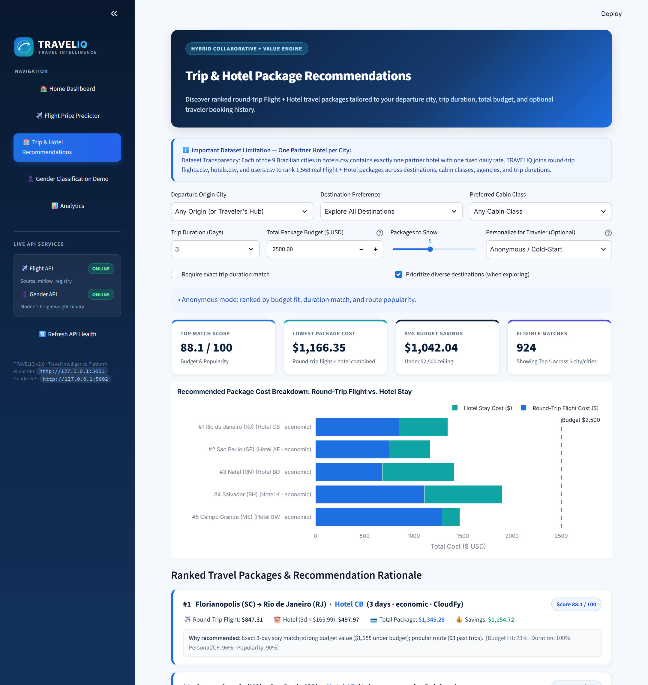
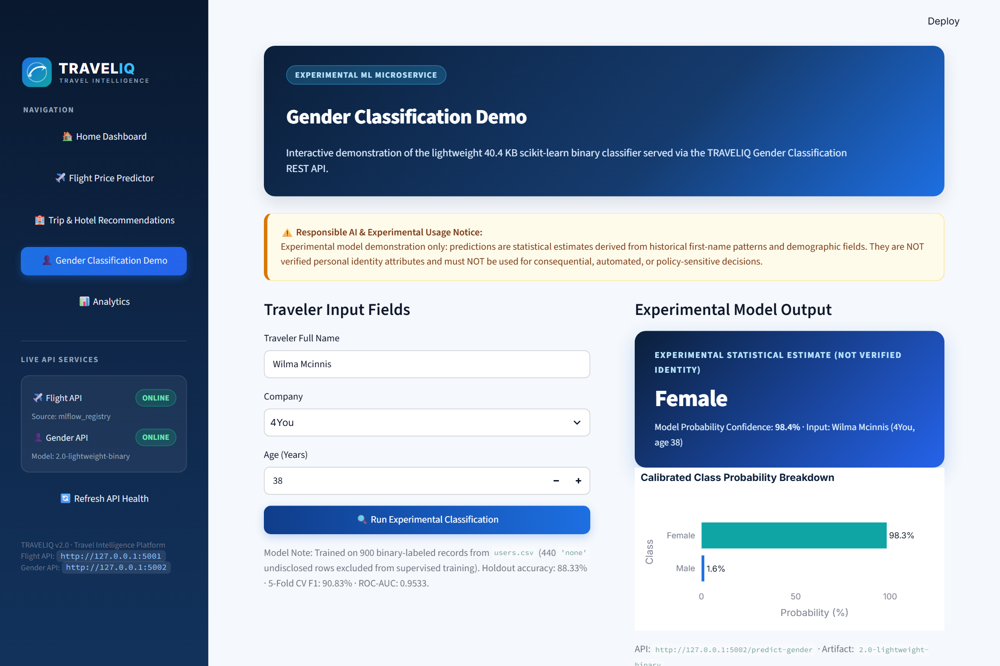
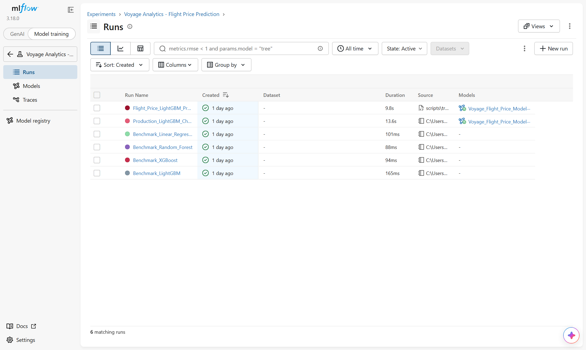
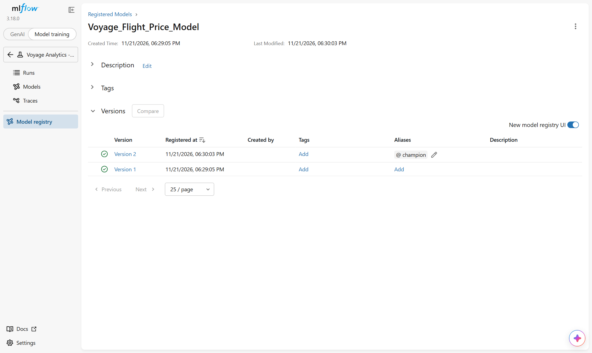

# TRAVELIQ — Travel Intelligence Platform

<p align="left">
  
</p>

**TRAVELIQ** is an end-to-end Travel & Tourism Machine Learning and MLOps platform unifying airfare price prediction, hybrid round-trip flight-and-hotel package recommendations, an experimental lightweight gender classification microservice, and interactive corporate travel market analytics.

> **Project Identity & Attribution:** TRAVELIQ was independently designed, re-engineered, and extended from an open-source travel MLOps starter repository (`voyage-analytics-mlops`) for a Travel & Tourism Machine Learning & MLOps Capstone Project. Full starter-project attribution and third-party open-source license notices are preserved in [ATTRIBUTION.md](ATTRIBUTION.md).

---

## 1. Problem Statement

Corporate travel platforms manage thousands of multi-leg itineraries across airlines, cabin classes, agencies, and partner hotels, yet decision-makers and travelers frequently encounter three operational gaps:

1. **Opaque Airfare Forecasting:** Static fare tables fail to generalize when evaluating new route, cabin, agency, or travel-date combinations, while naive random train/test splits severely overestimate model accuracy on repeated fare configurations.
2. **Fragmented Trip & Hotel Discovery:** Real-world travel datasets often exhibit sparse hotel inventories (in this dataset, exactly one partner hotel per destination city), making naive hotel-only recommenders misleading unless round-trip flight cost, stay duration, budget ceilings, and booking history are modeled jointly.
3. **Unreliable Production MLOps:** Deploying notebooks directly into production without strict data validation, leakage-free evaluation gates, model registry versioning, lightweight containerization, or automated tests leads to broken schemas, oversized multi-gigabyte images, and silent regressions.

---

## 2. Project Objectives

- **Leakage-Free Flight Fare Regression:** Build and evaluate a multi-model regression workflow using `GroupShuffleSplit` and `GroupKFold` over unique flight configurations (`MAE`, `MSE`, `RMSE`, `R²`) and serve the champion via MLflow Model Registry (`@champion`) with automatic local fallback.
- **Responsible Binary Gender Classification:** Statistically audit `"none"` gender records, treat undisclosed entries as unlabeled rather than a third gender class, replace the starter repository's 91.9 MB `SentenceTransformer`/PyTorch artifact with a **40.4 KB** pure `scikit-learn` pipeline, evaluate both stratified and unseen-first-name generalization honestly, and surface explicit Responsible AI disclaimers.
- **Transparent Hybrid Package Recommendations:** Join `flights.csv`, `hotels.csv`, and `users.csv` into **1,568 real round-trip Flight + Hotel packages**, transparently document the one-hotel-per-city constraint, evaluate User-Based Collaborative Filtering against a Popularity baseline, and deliver ranked recommendations with per-package cost breakdowns and rationale.
- **Cohesive Full-Stack Application & MLOps Stack:** Deliver a cohesive **TRAVELIQ** Streamlit dashboard backed by Waitress/Gunicorn Flask REST microservices, MLflow tracking & model registry, Docker & Docker Compose definitions, Kubernetes + HPA manifests, a 7-stage quality-gated Apache Airflow pipeline, a 7-stage Jenkins `Jenkinsfile`, and a comprehensive 57-test automated `pytest` suite.

---

## 3. System Architecture

```text
travel_capstone_dataset/ (flights.csv · hotels.csv · users.csv)
       │
       ├──► Phase 1 Notebooks (notebooks/01..03) & Training Pipeline (scripts/)
       │         │
       │         ├──► MLflow Tracking & Model Registry (:5000 / sqlite:///mlflow.db)
       │         │         └── Voyage_Flight_Price_Model (Version 2 · @champion)
       │         │
       │         └──► Versioned Production Artifacts (models/)
       │                   ├── flight_price_pipeline.joblib (896.3 KB · LightGBM)
       │                   └── gender_classifier.joblib     (40.4 KB · Pure sklearn)
       │
       ├──► Flask Flight Price API  (app/app.py        · :5001 · /health, /predict)
       ├──► Flask Gender API        (app/gender_api.py · :5002 · /health, /predict-gender)
       └──► Hybrid Package Engine   (app/recommender.py · 1,568 Flight + Hotel bundles)
                     │
                     ▼
        TRAVELIQ Streamlit Platform (streamlit_app.py · :8501)
          ├── 1. Home Dashboard (KPIs, overview charts, live API status)
          ├── 2. Flight Price Predictor (live MLflow @champion inference)
          ├── 3. Trip & Hotel Recommendations (budget/duration/CF ranking)
          ├── 4. Gender Classification Demo (experimental + Responsible AI notice)
          └── 5. Travel & Pricing Analytics (5 interactive Plotly tabs)

MLOps Orchestration & CI/CD Layer:
  ├── Docker Compose   (docker-compose.yml · traveliq-net · 4 services + persistent volume)
  ├── Kubernetes + HPA (kubernetes/*.yaml · probes, ConfigMap, PV, autoscaling/v2 HPAs)
  ├── Apache Airflow   (airflow/dags/traveliq_ml_pipeline.py · 7 gated stages + SHA-256 skip)
  └── Jenkins CI/CD    (Jenkinsfile · 7 cross-platform stages · JUnit · dry-run deploy check)
```

---

## 4. Datasets & Known Characteristics

All source datasets reside untouched in `travel_capstone_dataset/`:

| Dataset | Rows × Cols | Missing / Duplicates | Key Findings & Transparency Notes |
|---|---:|---:|---|
| `flights.csv` | `271,888 × 10` | `0` nulls · `0` exact dupes | 9 Brazilian regional cities, 70 active routes, 3 cabin classes (`economic`, `premium`, `firstClass`), 3 agencies (`CloudFy`, `Rainbow`, `FlyingDrops`), duration in **hours** (`0.44–2.44 h`), spanning `2019–2023`. Contains exactly **490 unique fixed-price flight configurations**, making group-based splitting mandatory to prevent route memorization leakage. |
| `hotels.csv` | `40,552 × 8` | `0` nulls · `0` exact dupes | **Exactly one partner hotel per destination city** (`9 cities ↔ 9 hotels`, each with one fixed daily rate, `1–4` stay days). Joined with round-trip `flights.csv` via `travelCode` (100% destination match) to construct **1,568 real round-trip Flight + Hotel packages**. |
| `users.csv` | `1,340 × 5` | `0` nulls (`440` literal `"none"`) | 5 corporate accounts (`4You`, `Acme Factory`, `Monsters CYA`, `Umbrella LTDA`, `Wonka Company`), ages `21–65`. Contains `452` `male`, `448` `female`, and `440` (`32.84%`) literal `"none"` records statistically verified as Missing Completely At Random (MCAR: company $\chi^2\ p=0.3750$, age ANOVA $p=0.6185$, `66.8%` first-name overlap with labeled users). Excluded from supervised training as undisclosed labels. |

---

## 5. Machine Learning Approaches & Verified Results

### 5.1 Flight Price Prediction (`notebooks/01_flight_price_prediction.ipynb` & `scripts/train_flight_model.py`)

- **Methodology:** Engineered route identifier (`from_to`), calendar features (`year`, `month`, `day`, `day_of_week` cast cleanly to `int32`), and numeric/categorical preprocessing inside a single `ColumnTransformer` + `Pipeline`. Used `GroupShuffleSplit` (`80/20` over the 490 unique configurations -> **98 completely unseen flight configurations**, `50,614` test rows) and 3-fold `GroupKFold` for tuning.
- **Verified Holdout Results (50,614 rows across 98 unseen flight configurations):**

| Model | MAE ($) | MSE | RMSE ($) | R² | Selection Status |
|---|---:|---:|---:|---:|---|
| **LightGBM** | **41.73** | **2,754.14** | **52.48** | **0.9765** | **Production Champion (`@champion` v2 · 896.3 KB)** |
| XGBoost | 43.09 | 2,966.09 | 54.46 | 0.9746 | Benchmark |
| LightGBM (`GroupKFold` Tuned) | 45.28 | 2,944.11 | 54.26 | 0.9748 | Benchmark |
| Random Forest | 54.63 | 4,976.75 | 70.55 | 0.9575 | Benchmark |
| Linear Regression | 82.13 | 10,001.39 | 100.01 | 0.9145 | Baseline |

### 5.2 Binary Gender Classification (`notebooks/02_gender_classification.ipynb` & `app/gender_features.py`)

- **Methodology & Discrepancy Resolution:** The starter project reported `~0.52` F1 because it treated 440 undisclosed `"none"` rows as a genuine 3rd target class (`"none"` recall `0.17–0.33`). Removing undisclosed labels leaves **900 cleanly labeled binary records** (`720 train / 180 stratified test`, zero overlapping user codes or full names). TRAVELIQ extracts deterministic first-name character n-grams (`2–5`), word unigrams, morphological features (length, ending vowels/suffixes), company, and age inside a pure `scikit-learn` pipeline — reducing artifact size from **91.9 MB** (`SentenceTransformer` + PyTorch) to **40.4 KB**.
- **Verified Holdout Results (`180` stratified test rows, 5-Fold Stratified CV):**

| Model | 5-Fold CV F1 | Test Accuracy | Test Precision | Test Recall | Test Weighted F1 | Test ROC-AUC |
|---|---:|---:|---:|---:|---:|---:|
| **Tuned Logistic Regression (`C=8.0`, Saved)** | **0.9083** | **0.8833** | **0.8872** | **0.8833** | **0.8830** | **0.9533** |
| Random Forest | 0.8989 | 0.8889 | 0.8920 | 0.8889 | 0.8887 | 0.9666 |
| Calibrated LinearSVC | 0.9040 | 0.8833 | 0.8872 | 0.8833 | 0.8830 | 0.9552 |
| XGBoost | 0.8636 | 0.8722 | 0.8745 | 0.8722 | 0.8720 | 0.9232 |
| LightGBM | 0.8672 | 0.8611 | 0.8648 | 0.8611 | 0.8608 | 0.9426 |

- **Confusion Matrix (Saved Model, `n=180`):** `female`: `75 TP / 15 FN`; `male`: `84 TP / 6 FN`.
- **Transparent Seen vs. Unseen First-Name Generalization Analysis:**
  - *Seen first names in stratified test (`110/180` rows, `61.1%`)*: Accuracy `0.9727`, Weighted F1 `0.9726` (reflecting recurring common first names across distinct users).
  - *Brand-new first names in stratified test (`70/180` rows, `38.9%`)*: Accuracy `0.7429`, Weighted F1 `0.7454`.
  - *Strict `GroupShuffleSplit` holding out entire first-name groups (`n=168`, `0%` shared first names)*: Accuracy `0.6369`, Weighted F1 `0.6366` (character n-gram & morphological generalization alone).
  - TRAVELIQ's automated MLOps pipeline (`scripts/mlops_pipeline.py`) enforces **both** a stratified Weighted F1 gate (`>= 0.85`) and an unseen-first-name `GroupShuffleSplit` F1 gate (`>= 0.58`) before promotion.

### 5.3 Hybrid Travel & Hotel Package Recommender (`notebooks/03_travel_recommendation.ipynb` & `app/recommender.py`)

- **Methodology:** Joins `hotels.csv` with round-trip `flights.csv` and `users.csv` into **1,568 real packages**. Combines User-Based Collaborative Filtering (cosine similarity over historical user-destination matrices) with a transparent `0–100` multi-factor score balancing budget fit, trip duration alignment, personal/CF destination affinity, and route popularity, plus optional destination-diversity ranking.
- **Verified Offline & Query-Level Evaluation:**
  - **Collaborative Filtering (`1,228` users, time-ordered 80/20 split, `K=3`):** User-Based CF achieves **HitRate@3 = `0.8974`**, **Precision@3 = `0.5532`**, **Recall@3 = `0.3672`**, **NDCG@3 = `0.5680`**, and **100.0% Catalog Coverage** (`9/9` cities), compared to a Popularity baseline (`HitRate@3 = 0.8933`, `Precision@3 = 0.5611`, `33.3%` coverage).
  - **Hybrid Package Engine (`200` randomized queries):** **100.0% Budget Compliance**, **89.7% Exact Duration Match**, **4.78 / 5.00** average unique destinations per Top-5 explorer query, **95.5%** personalization differentiation vs. anonymous mode, and **6/6** edge cases passed. Production `app/recommender.py` reproduces Notebook 03 benchmark scores to exact hundredth parity (`71.28`, `76.99`, `54.91`).

---

## 6. REST API Documentation

Both microservices are served via **Waitress** locally (`python -m ...`) and **Gunicorn** in Docker containers, with structured JSON validation and consistent HTTP status codes (`200`, `400`, `500`).

### Flight Price API (`app/app.py`, Port `5001`)

- **`GET /health`** — Live observed response when connected to MLflow (`http://127.0.0.1:5000`):
```json
{
  "alias": "champion",
  "model": "Voyage_Flight_Price_Model",
  "model_source": "mlflow_registry",
  "service": "traveliq-flight-api",
  "status": "healthy"
}
```
- **`POST /predict`** — Example request & live observed response:
```json
// Request
{
  "from": "Recife (PE)",
  "to": "Florianopolis (SC)",
  "flightType": "firstClass",
  "agency": "FlyingDrops",
  "date": "2020-07-15",
  "time": 1.76,
  "distance": 676.53
}

// Response (200 OK)
{
  "currency": "USD",
  "input_summary": {
    "agency": "FlyingDrops",
    "date": "2020-07-15",
    "distance_km": 676.53,
    "flightType": "firstClass",
    "from": "Recife (PE)",
    "time_hours": 1.76,
    "to": "Florianopolis (SC)"
  },
  "model": "Voyage_Flight_Price_Model",
  "model_alias": "champion",
  "model_source": "mlflow_registry",
  "predicted_price": 1429.45
}
```

### Gender Classification API (`app/gender_api.py`, Port `5002`)

- **`GET /health`** — Live observed response:
```json
{
  "artifact_size_kb": 40.4,
  "artifact_version": "2.0-lightweight-binary",
  "classes": ["female", "male"],
  "model": "gender_classifier",
  "model_type": "LogisticRegression (First-Name Char/Word TF-IDF + Morphology + Demographics)",
  "service": "traveliq-gender-api",
  "status": "healthy"
}
```
- **`POST /predict-gender`** — Example request & live observed response:
```json
// Request
{"name": "Charlotte Johnson", "company": "Acme Factory", "age": 31}

// Response (200 OK)
{
  "artifact_version": "2.0-lightweight-binary",
  "confidence": 0.9729,
  "experimental": true,
  "experimental_notice": "Experimental model demonstration only: predictions are statistical estimates derived from historical first-name patterns and demographic fields. They are NOT verified personal identity attributes and must NOT be used for consequential, automated, or policy-sensitive decisions.",
  "model": "gender_classifier",
  "predicted_gender": "female",
  "probabilities": {"female": 0.9729, "male": 0.0271}
}
```

---

## 7. TRAVELIQ UI & Live MLflow Screenshots

All screenshots below were captured directly from the live running TRAVELIQ platform (`:8501`), Flask APIs (`:5001`, `:5002`), and MLflow server (`:5000`):

### 1. Home Dashboard (KPIs, Quick Launch, Overview Charts & Live API Health Badges)


### 2. Flight Price Predictor (Live MLflow `@champion` Inference)


### 3. Trip & Hotel Package Recommendations (Dataset Transparency, Cost Breakdown & Rationale)


### 4. Gender Classification Demo (Calibrated Probabilities & Responsible AI Notice)


### 5. Travel & Pricing Analytics (Interactive Plotly Market Intelligence)


### 6. Live MLflow Tracking Server — Flight Price Experiments (6 Logged Runs)


### 7. Live MLflow Model Registry — `Voyage_Flight_Price_Model` Version 2 (`@champion`)


---

## 8. MLOps Architecture & Verification Status

See [docs/MLOPS_ARCHITECTURE.md](docs/MLOPS_ARCHITECTURE.md) and [docs/TRAVELIQ_Technical_Workflow_Documentation.md](docs/TRAVELIQ_Technical_Workflow_Documentation.md) (plus the Google-Docs-ready `.docx` version) for full design rationale.

| MLOps Layer | Key Files | Verification Status | Notes |
|---|---|---|---|
| **MLflow Tracking & Registry** | `mlflow.db`, `scripts/train_flight_model.py`, `app/app.py` | **PASS (Live)** | Executed live on `:5000`; `Voyage_Flight_Price_Model@champion` v2 served over HTTP to Flight API (`diff = 0.000000` vs local `.joblib`). |
| **Flask APIs & Streamlit UI** | `app/app.py`, `app/gender_api.py`, `streamlit_app.py` | **PASS (Live)** | All endpoints, health checks, validation errors, fallback behavior, and all 5 Streamlit pages verified live. |
| **Automated Pytest Suite** | `tests/test_*.py` (5 modules) | **PASS (`57/57`)** | Unit, infrastructure static validation, live HTTP integration, and isolated Airflow/MLflow pipeline execution all pass. |
| **Apache Airflow Pipeline** | `scripts/mlops_pipeline.py`, `airflow/dags/traveliq_ml_pipeline.py`, `airflow/docker-compose.yml` | **PARTIAL** | All 7 pipeline stages, SHA-256 skip gate, dual F1 gates, and failure blocking executed live in isolated sandbox (**PASS**); Dockerized Airflow Webserver/Scheduler UI **NOT TESTED** (requires Docker Desktop + WSL2). |
| **Docker & Docker Compose** | `docker/Dockerfile*`, `gender/Dockerfile`, `docker-compose.yml` | **PARTIAL** | Multi-service images, non-root users, healthchecks, `libgomp1`, PyTorch removal, and cross-service wiring statically verified by pytest (**PASS**); live `docker compose up --build` **NOT TESTED** (Docker Desktop not installed on non-admin Windows host). |
| **Kubernetes & HPA** | `kubernetes/*.yaml` | **PARTIAL** | Validated YAML schema, image tags, probes, ConfigMap, PVC, and `autoscaling/v2` HPAs (**PASS**); live cluster rollout & HPA load test **NOT TESTED** (`kubectl`/local cluster unavailable). |
| **Jenkins CI/CD** | `Jenkinsfile` | **PARTIAL** | 7-stage cross-platform `Jenkinsfile` structure, JUnit archiving, credential hygiene, and non-prod `--dry-run=client` guard statically verified (**PASS**); live Jenkins server execution **NOT TESTED**. |

---

## 9. Running TRAVELIQ Locally

### Option A — Native Python Execution (Verified on Windows 11 / Python 3.13)

```powershell
# 1. Create and activate virtual environment
python -m venv .venv
.\.venv\Scripts\Activate.ps1
pip install -r requirements.txt

# 2. (Optional) Start local MLflow Tracking & Model Registry UI (Port 5000)
mlflow server --backend-store-uri sqlite:///mlflow.db --host 127.0.0.1 --port 5000 --allowed-hosts "localhost:*,127.0.0.1:*,host.docker.internal:5000"

# 3. Terminal 2 — Start Flight Price REST API (Port 5001)
$env:MLFLOW_TRACKING_URI = "http://127.0.0.1:5000"
python -m app.app

# 4. Terminal 3 — Start Gender Classification REST API (Port 5002)
python -m app.gender_api

# 5. Terminal 4 — Launch TRAVELIQ Web Application (Port 8501)
streamlit run streamlit_app.py
```

Open **`http://localhost:8501`** for TRAVELIQ and **`http://localhost:5000`** for MLflow.

### Option B — Full Container Stack via Docker Compose (Requires Docker Desktop)

```bash
docker compose up --build -d
docker compose ps
curl http://localhost:5001/health
curl http://localhost:5002/health
```

### Option C — Kubernetes + HPA Rollout (Requires `kubectl` + Local Cluster + `metrics-server`)

```bash
kubectl apply -f kubernetes/configmap.yaml
kubectl apply -f kubernetes/mlflow.yaml
kubectl apply -f kubernetes/deployment.yaml
kubectl apply -f kubernetes/service.yaml
kubectl apply -f kubernetes/gender-classifier.yaml
kubectl apply -f kubernetes/streamlit.yaml
kubectl apply -f kubernetes/hpa.yaml
kubectl get pods,svc,hpa
```

### Option D — Run the Full Automated Test Suite

```powershell
pip install -r requirements-dev.txt
pytest -v
```

### Environment Variables

| Variable | Default | Purpose |
|---|---|---|
| `FLIGHT_API_URL` | `http://127.0.0.1:5001` | Flight API endpoint consumed by Streamlit |
| `GENDER_API_URL` | `http://127.0.0.1:5002` | Gender API endpoint consumed by Streamlit |
| `MLFLOW_TRACKING_URI` | Auto (`:5000` -> `sqlite:///mlflow.db`) | MLflow tracking and registry server URI |
| `MODEL_NAME` | `Voyage_Flight_Price_Model` | Registered MLflow flight model name |
| `MODEL_ALIAS` | `champion` | Registered model alias served in production |
| `ENABLE_LOCAL_MODEL_FALLBACK` | `1` | Fall back to `models/flight_price_pipeline.joblib` if MLflow is unavailable |

---

## 10. Limitations & Responsible AI

1. **One Partner Hotel per City (`hotels.csv`):** Because each of the 9 Brazilian cities has exactly one hotel with a fixed daily price, TRAVELIQ recommends combined round-trip **Flight + Hotel packages** rather than fabricating multi-hotel competition within a city.
2. **490 Fixed-Price Flight Configurations (`flights.csv`):** Prices in the synthetic corporate dataset are fixed per route/cabin/agency/date-pattern configuration. `GroupShuffleSplit` evaluates true generalization to 98 unseen configurations (`RMSE = $52.48`) rather than memorized lookup tables.
3. **Gender Model Generalization & Ethics:** Predicting gender from first names and demographic columns is an inherently statistical approximation (`0.9726` F1 on seen common first names vs. `0.7454` on unseen names in the holdout split and `0.6366` under strict first-name group holdout). TRAVELIQ explicitly labels this microservice as **experimental** and prohibits its use for identity verification, hiring, pricing, or policy-sensitive decisions.
4. **Local Infrastructure Execution Scope:** Live container builds (`Docker`), cluster rollouts (`Kubernetes/HPA`), Dockerized Airflow UI, and Jenkins server execution require Docker Desktop + WSL2/Hyper-V (Windows Administrator elevation) and are clearly marked pending until executed on a container-enabled host.

---

## 11. Capstone Deliverables & Documentation Index

- **Jupyter Notebooks (Executed End-to-End):**
  - `notebooks/01_flight_price_prediction.ipynb`
  - `notebooks/02_gender_classification.ipynb`
  - `notebooks/03_travel_recommendation.ipynb`
- **Technical Documentation:**
  - `docs/TRAVELIQ_Technical_Workflow_Documentation.docx` *(formatted for direct Google Docs upload, with embedded screenshots)*
  - `docs/TRAVELIQ_Technical_Workflow_Documentation.md` *(Markdown mirror)*
  - `docs/MLOPS_ARCHITECTURE.md` *(Infrastructure deep dive)*
- **Presentation & Submission Pack:**
  - `docs/TRAVELIQ_Capstone_Presentation.pptx` *(PowerPoint slide deck)*
  - `docs/TRAVELIQ_40Min_Presentation_Script.md` *(Timed 40-minute walkthrough script with personal reflection prompts)*
  - `docs/SUBMISSION_CHECKLIST.md` *(Complete verification checklist)*
- **Attribution & Open-Source Licenses:**
  - [ATTRIBUTION.md](ATTRIBUTION.md)

---

## 12. Repository Structure

```text
.
├── .streamlit/config.toml                      # TRAVELIQ Navy/White/Blue Streamlit theme
├── airflow/
│   ├── Dockerfile                              # Pinned Airflow 2.10.5 + ML stack
│   ├── docker-compose.yml                      # Healthchecked Postgres + Airflow LocalExecutor
│   └── dags/traveliq_ml_pipeline.py            # 7-stage gated retraining DAG
├── app/
│   ├── api_client.py                           # HTTP client with structured error handling
│   ├── app.py                                  # Flight Price API (Waitress/Gunicorn · :5001)
│   ├── config.py                               # Centralized environment-driven config
│   ├── gender_api.py                           # Gender API (40.4 KB artifact · :5002)
│   ├── gender_features.py                      # Deterministic sklearn feature engineering
│   └── recommender.py                          # Hybrid 1,568-package recommender engine
├── assets/traveliq_logo.svg                    # TRAVELIQ vector logo
├── docker/                                     # Flight, Streamlit, MLflow Dockerfiles & reqs
├── docs/                                       # Technical DOCX/MD, PPTX, Script, Checklist
├── gender/                                     # Lightweight Gender Dockerfile & reqs (no PyTorch)
├── kubernetes/                                 # ConfigMap, MLflow, APIs, UI, HPAs, Secret template
├── models/
│   ├── flight_price_pipeline.joblib            # LightGBM production artifact (896.3 KB)
│   └── gender_classifier.joblib                # Pure sklearn binary artifact (40.4 KB)
├── notebooks/                                  # 3 executed, Colab-compatible capstone notebooks
├── screenshots/                                # Real captured UI & MLflow evidence (01..07)
├── scripts/
│   ├── mlops_pipeline.py                       # 7-stage quality-gated retraining engine
│   └── train_flight_model.py                   # Flight regression training & MLflow registration
├── tests/                                      # 57 automated unit, infra & integration tests
├── travel_capstone_dataset/                    # Untouched flights.csv, hotels.csv, users.csv
├── ATTRIBUTION.md                              # Starter-project & OSS library attribution
├── docker-compose.yml                          # Full 4-service TRAVELIQ Docker stack
├── Jenkinsfile                                 # 7-stage cross-platform CI/CD pipeline
├── README.md                                   # Project overview & quickstart
├── requirements.txt                            # Pinned production dependencies
├── requirements-dev.txt                        # Development, notebook & pytest dependencies
└── streamlit_app.py                            # TRAVELIQ 5-page Streamlit web application
```
